# 04 — Interface Visual

Time: Davi, Fabio, Pedro e Breno (Hackathon iFood × SEMCOMP 29, 17–18/10/2026).

O produto tem duas interfaces:
- **A conversa no WhatsApp**, para quem compra. Nenhum app novo: a interface é o próprio WhatsApp, com botões, listas e cards com foto.
- **O dash do time**, para quem opera (React + Vite), com os agentes, o uso do MCP, o dinheiro e as conversas ao vivo.

## Parte A — A conversa no WhatsApp

Regras visuais que valem em todas as telas:
- Frases curtas, um emoji por ideia (🛒 pedido, 🏠 endereço, 💳 pagamento, 💰 valor), negrito no que importa.
- Toda mensagem termina com o próximo passo, em botões.
- Nada em inglês chega à tela.

### A1. Boas-vindas
> Oi, Maria! 😊
> O que você quer pedir hoje? Pode escrever ou mandar áudio.

Logo abaixo, a vitrine: "Separei umas ideias pra você 👇", com cards de sugestão.
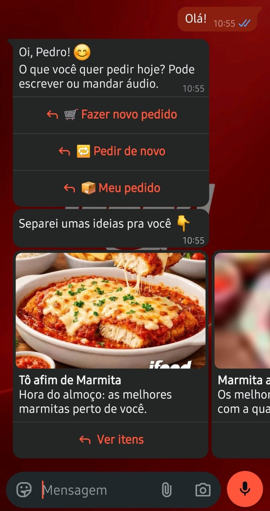

### A2. Login no iFood
> 🔐 Primeiro, preciso que você entre na sua conta do iFood.

Botão **Entrar no iFood**, que abre o login oficial. Na volta, o bot mostra de quem é a conta ("Não é a sua conta? Escreva *sair*").
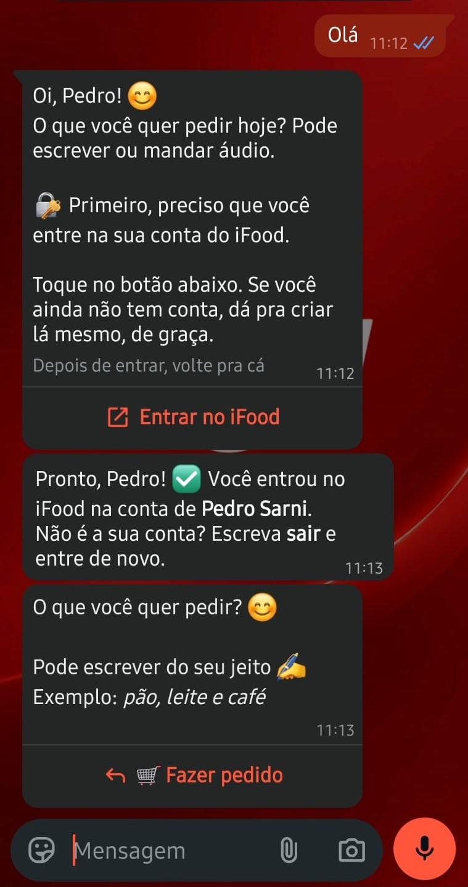

### A3. Lista entendida (texto, áudio ou foto)
> 📝 Anotei sua lista:
> 1. 2x leite
> 2. 1x pão
> 3. 1x café

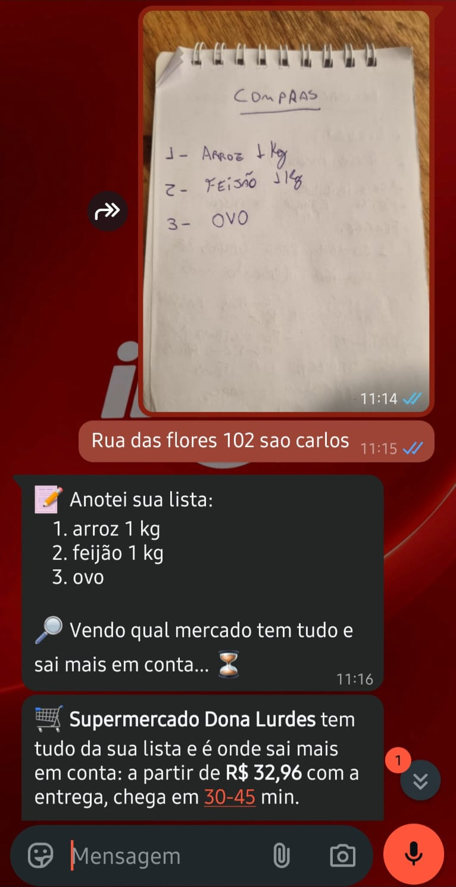

### A4. Opções com foto
Carrossel de cards (até 10 por vez), cada um com foto, nome, preço e loja, e botão **Quero esse**. Embaixo, **➕ Mais opções**.
> Gostou de algum? Toque em *Quero esse* 👆

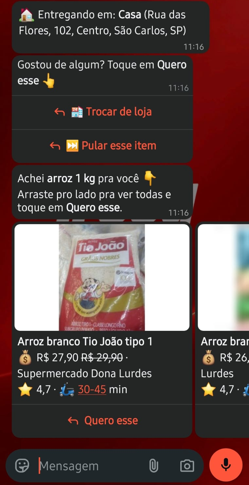

### A5. Resumo e confirmação
Itens, entrega (prazo e taxa), pagamento, endereço e total, com **✅ Confirmar pedido**, **✏️ Mudar algo** e **❌ Cancelar**.
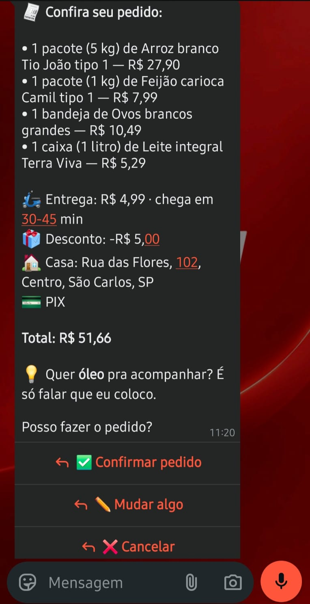

### A6. Pedido feito e acompanhamento
> 🎉 *Pedido feito!*

Depois, uma mensagem por mudança de status, sempre dizendo qual pedido é (loja, itens e valor).
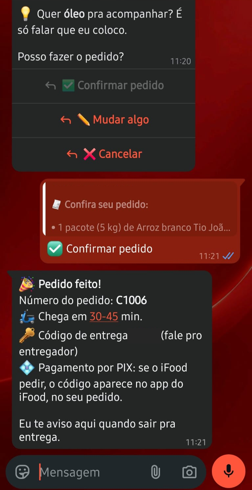

### A7. Lembrete de compra recorrente
> 🔔 Chegou o dia! Tá com fome de quê? A gente já sabe. 😋
> 🧾 itens · 🏪 loja · 🏠 endereço · 💳 pagamento · 💰 Itens: R$ 69,98 + entrega (pode variar um pouquinho)
> *Podemos pedir aqui pra enviar na sua casa?*

Botões: **Sim, pode pedir**, **Hoje não**, **Parar lembretes**.
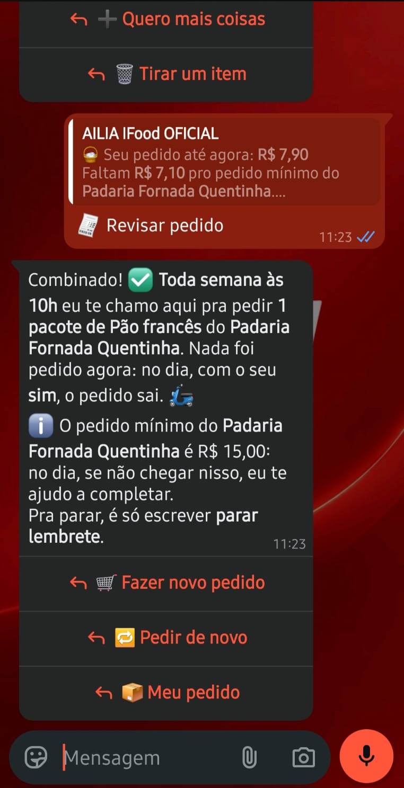
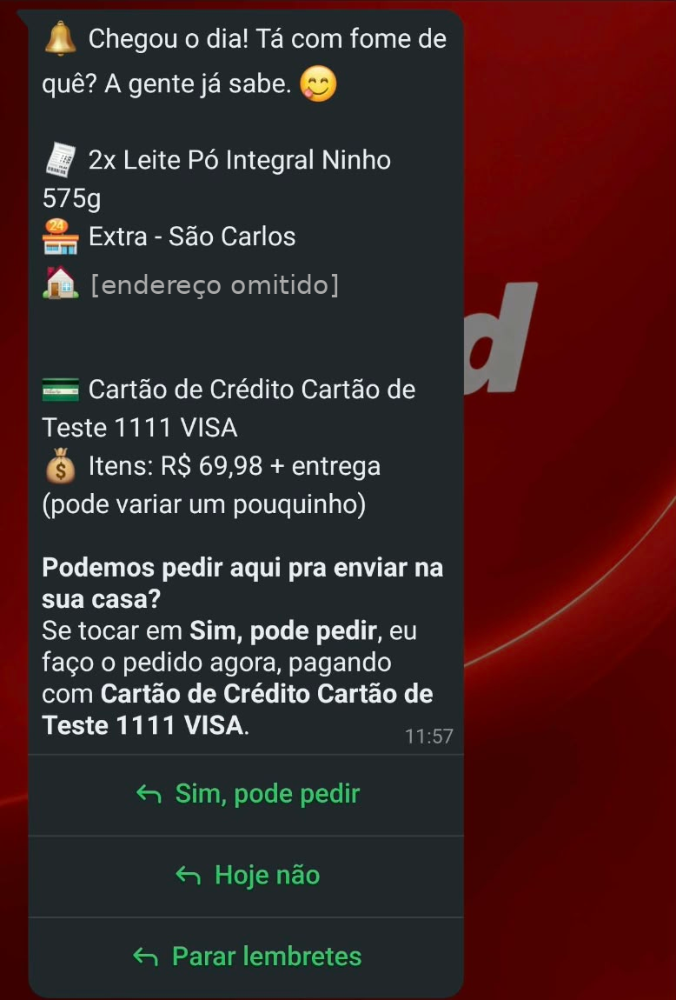

### A8. Kit em grupo
> 👥 Kit pra 8 pessoas · <loja>
> Itens com preço · 🛵 Entrega: grátis · 💰 Total
> 👥 R$ 42,98 por pessoa (8 pessoas)
> ✅ Dentro do seu limite de R$ 350,00
> Pode ser? Toque em *Quero esse kit* ou me diga o que mudar (ex.: _sem refri_, _mais barato_).

Botões: **✅ Quero esse kit**, **🔄 Outra loja**, **❌ Não quero**.
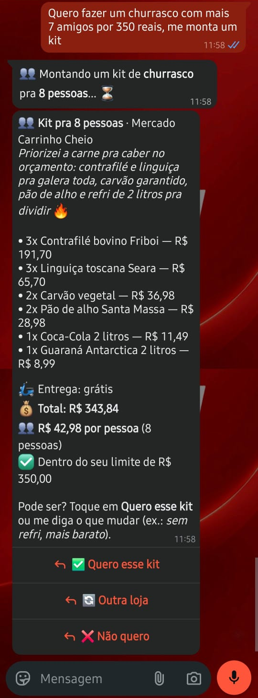

### A9. Ajuda e papo fora do assunto
> Eu faço pedidos no iFood pra você. 🛒
> 1️⃣ Me escreva o que você quer · 2️⃣ Eu mostro as opções com foto · 3️⃣ Você toca em *Quero esse* · 4️⃣ No final eu mostro o resumo e você confirma
> Nada é comprado sem você confirmar.

Papo fora do assunto ("Me conta uma piada") recebe uma recusa leve da própria IA e volta ao pedido, como na captura abaixo:
> Haha, piada não é meu forte, mas sei fazer pedido rapidinho! 😄 Que tal uma marmita ou um lanche? É só me dizer o que você quer 😉
> O que você quer pedir? Pode escrever do seu jeito ✍️ Exemplo: pão, leite e café

Botão **Ver opções**. Sem a IA, a resposta fixa é "Eu só sei fazer pedidos no iFood 🙂". A explicação em 4 passos acima é a resposta de "ajuda" e não tem print.
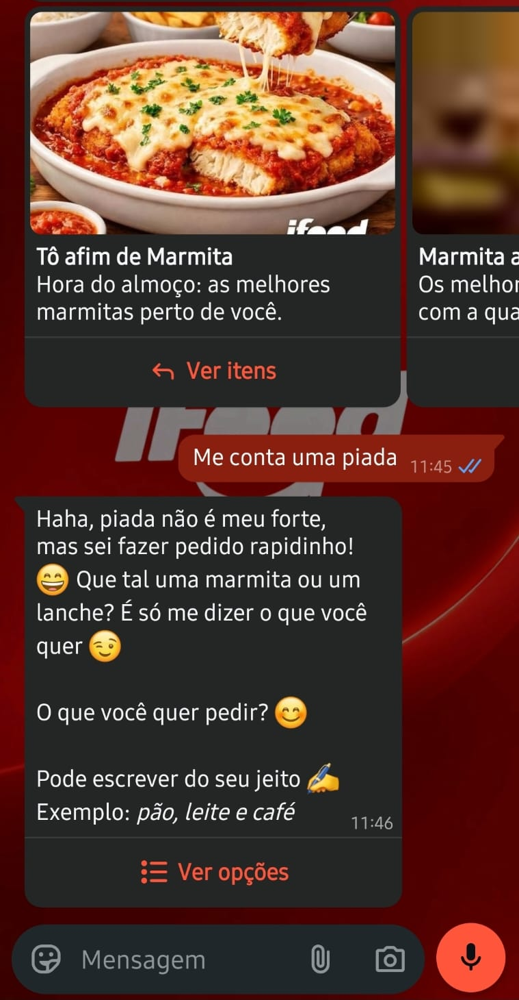

## Parte B — O dash do time

Identidade: vermelho `#EA1D2C`, branco e cinza. Duas fontes de dados no seletor do topo: **Dados reais** (o diário do bot ao vivo) e **Demonstração** (conversas simuladas, sempre com esse rótulo). Modo básico como padrão, avançado sob demanda.

Menu: **Agentes → Uso do MCP → Dinheiro → Conversas**, e "Mais análises" (Conversão, Clientes, Mercado, Relatórios).

### B1. Agentes
- Palco ao vivo: cada passo vira um recado entre cliente, Maestro, agente e iFood.
- Time de agentes com crachá: Lia (intérprete), Íris (fotos), Duda (curadora), Beto (kits), Tungs (tutor), Vina (voz), Otto (ouvinte); Sofia (analista) trabalha só no dash.
- Ficha de cada agente: modelo, prompt (com aviso de deploy pendente), keys mascaradas e interruptor.
- Rotinas automáticas: cutucada, carrinho esquecido, lembrete de recompra e rastreio, com disparos e desfecho.
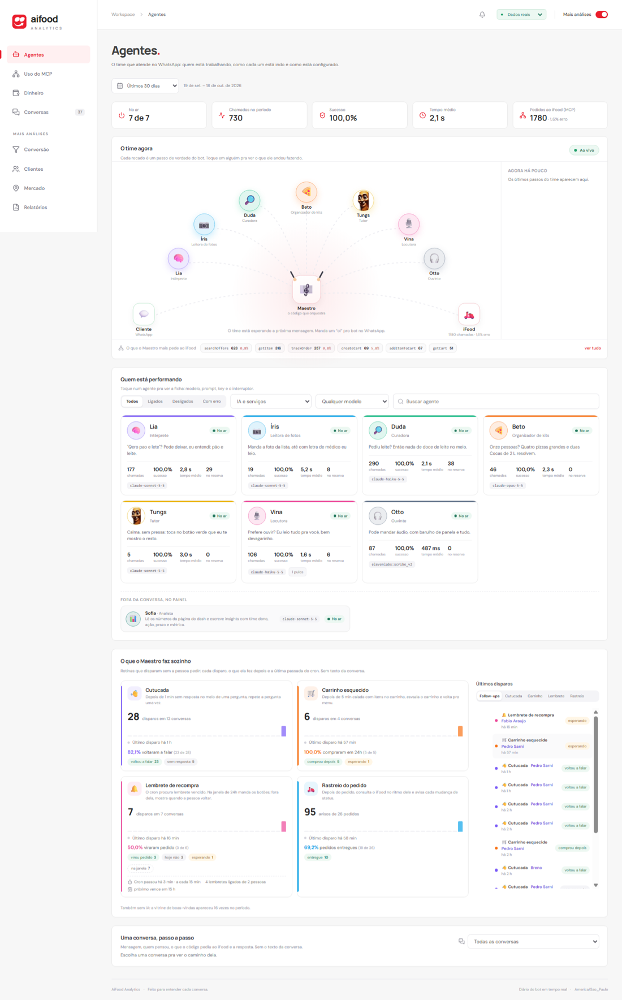

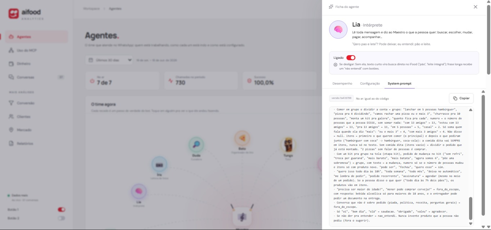

### B2. Uso do MCP
Cada chamada ao iFood: tool, tempo, sucesso ou erro. Mostra onde o gateway falha.
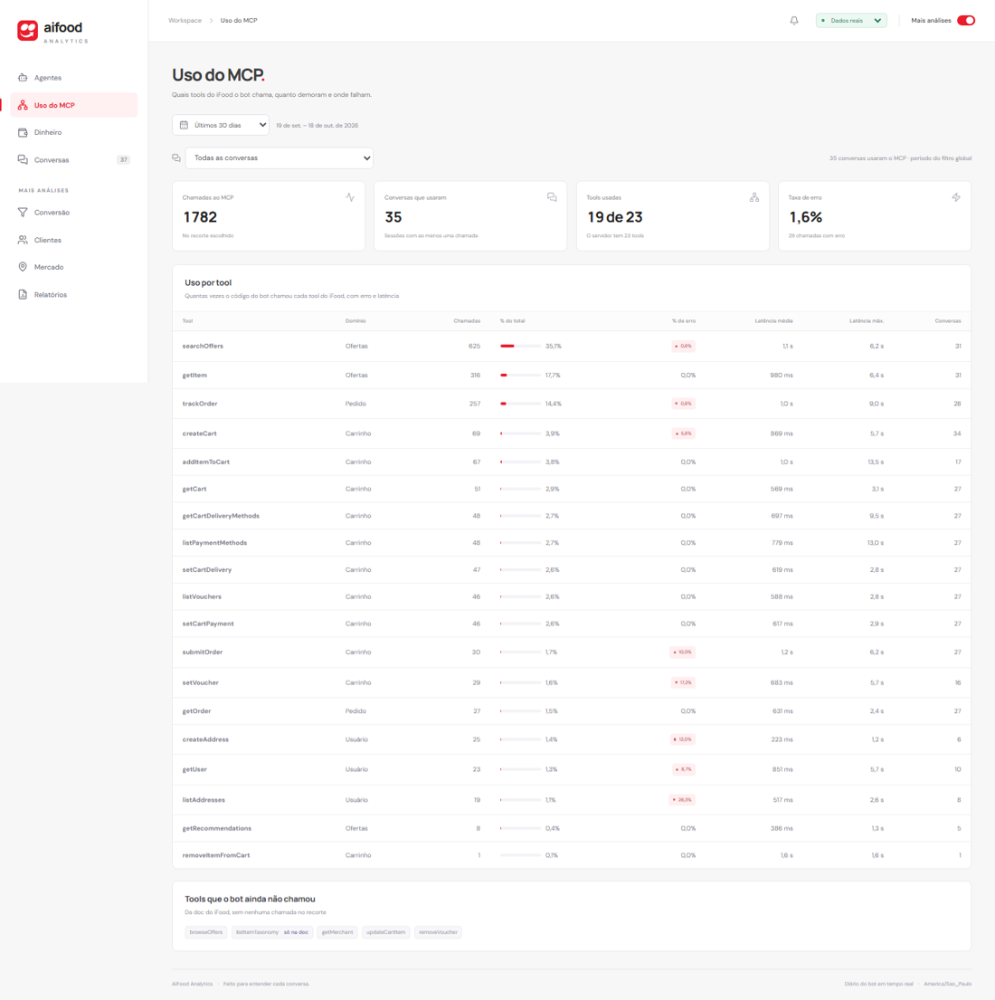

### B3. Dinheiro e Conversão
Vendas, funil (recomendação → seleção → carrinho → checkout → pedido → entrega), abandono e recuperação.
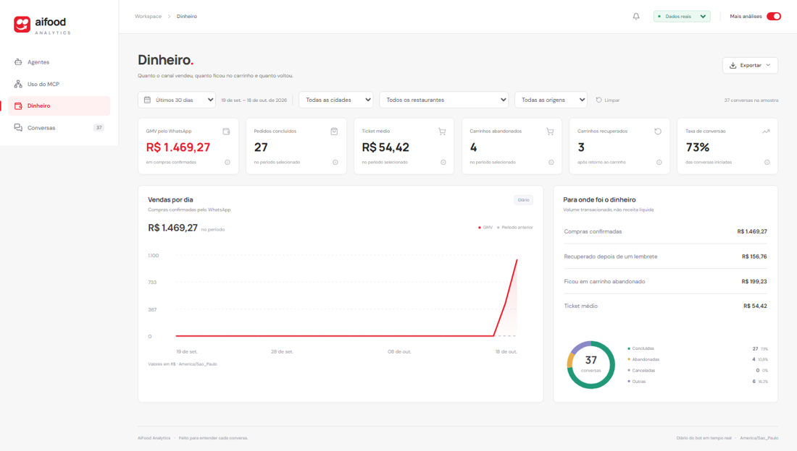

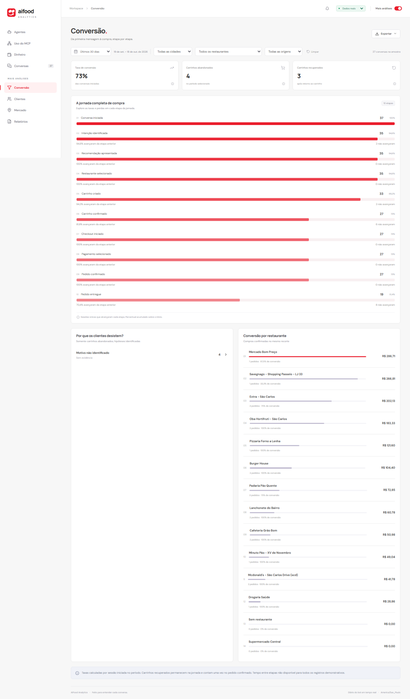

### B4. Conversas
Tabela com busca e filtros. O drawer mostra a conversa em ordem, com CPF e telefone mascarados.
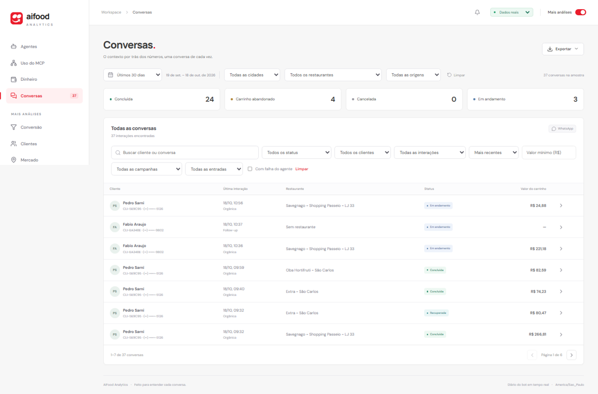

[PREENCHER: painel da conversa aberta]

### B5. Insights com IA
Botão flutuante nas páginas Conversão, Clientes e Mercado. A Sofia devolve 3 a 5 insights, cada um com time dono, evidência, ação, impacto, prazo e métrica. Exporta em PDF.
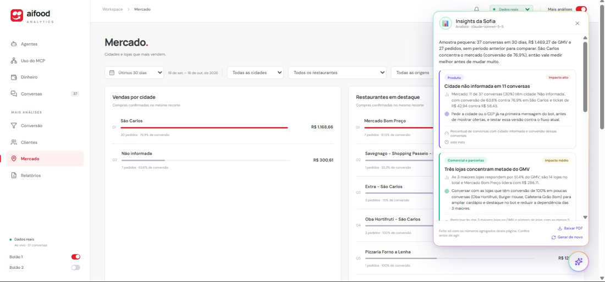

## Como ver ao vivo
- WhatsApp: [PREENCHER número ou QR de demonstração, se a banca puder testar].
- Dash: roda local (`npm run dev` em `Frontend/Rascunho_Dash`, com `python -m src.painel.servidor` na raiz).
